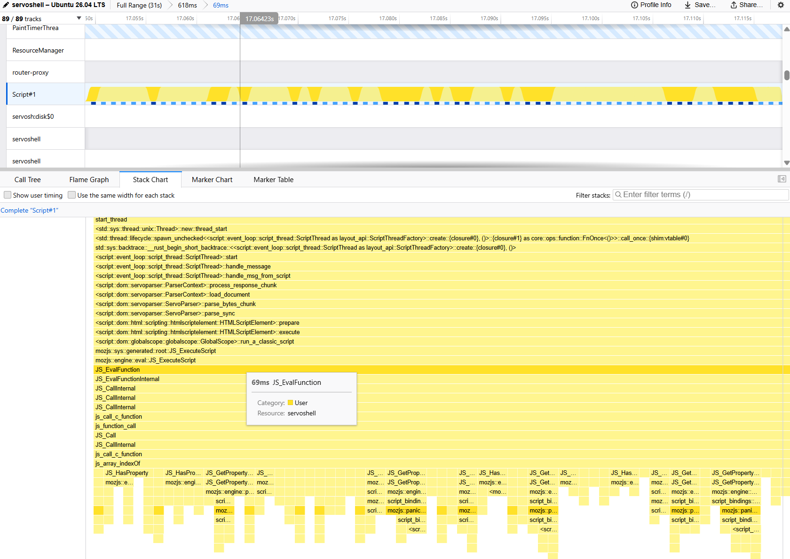

# [mstange/samply](https://github.com/mstange/samply)

Linux上使用perf events采样的CPU Profiler。包含CallTree, Flame Graph, Stack Chart(简单来说就是栈结构变化的trace，但是是采样得到的，对于复杂系统的代码理解等还是比较有帮助。因为复杂系统的分支条件以及回调不是很容易找)。

Stack Chart如下：

